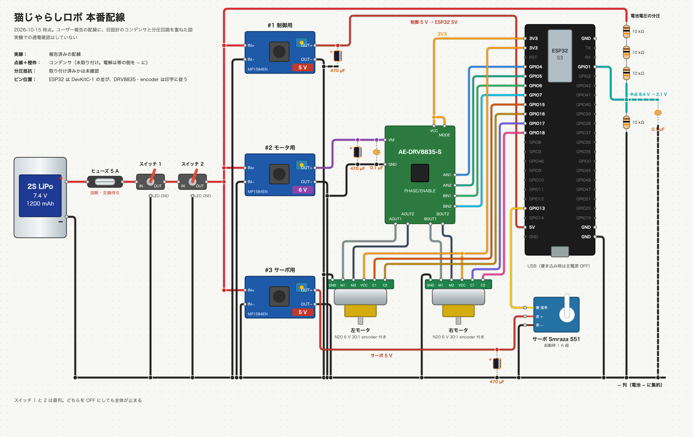
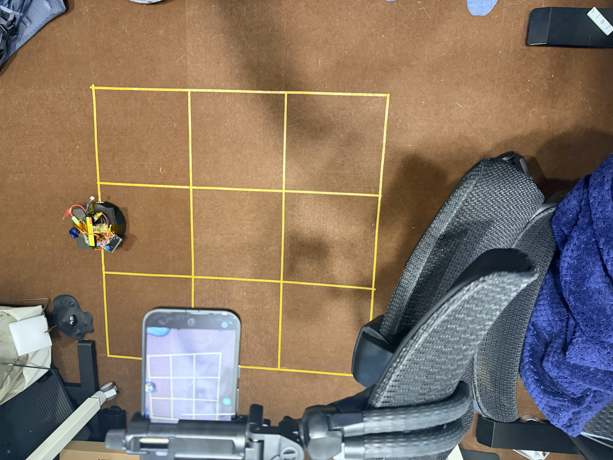
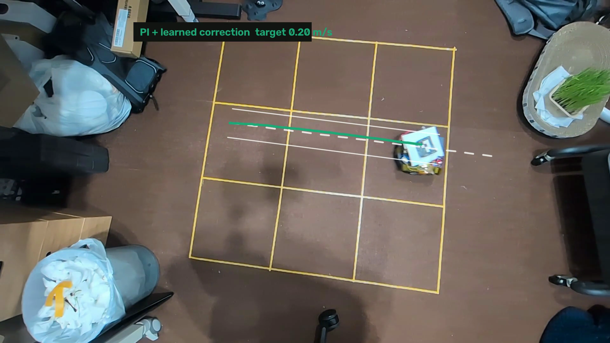
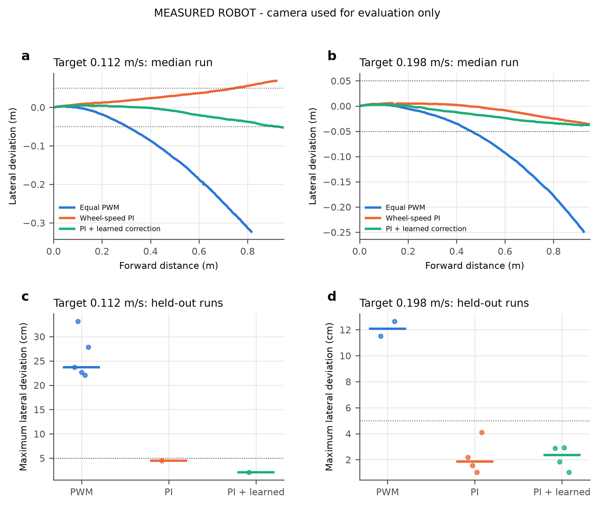

PAI 応用編 最終課題：走行データによる直進補正

# コンセプト

出発点は、猫じゃらしを動かしながら走る小さなロボットを自作し、猫を喜ばせることだった。回路設計からプログラム作成まで生成 AI を使い、当初は 2 つのサーボモーターで走行し、もう 1 つで猫じゃらしを動かす構想で製作を始めた。

しかし、初めて実機を作ってみると、サーボの扱いや部品の取り付けなど、設計とコードだけでは済まない難しさにぶつかった。現在の車台は回転を測れる DC モーターを使っているが、左右に同じ出力を与えるだけでは右へ曲がる。モーターや車輪の個体差、床との接地の違いが考えられるが、原因を個別には特定していない。猫と遊ぶ動きを考える前に、意図した方向へ走らせることが課題になった。

そこで今回の講座課題では、猫じゃらしロボット全体の完成を目指すのではなく、その土台となる直進動作に対象を絞った。限られた時間で機械設計をやり直す代わりに、実際の動きを測り、車輪の速度制御と、走行データから学ぶ補正を組み合わせた。

取り組みの中心は、不完全な実機を、観測・制御・学習・評価を通じて狙った動きに近づけることである。基盤モデルも試すが、使ったこと自体を成果とはせず、単純な制御や回帰と比べて役に立つかを実測で判断する。猫と遊べるロボットの完成には至っていないが、その手前で直面した問題に対し、何が改善し、何が残ったかを報告する。

# 目的

本課題の目的は、思いどおりに動かない自作ロボットに対し、講座で学んだ測定・制御・学習を使って改善する一連の工程を実機で経験し、その効果と限界を確かめることである。猫の認識や猫じゃらしの動作には進まず、車台の直進を今回の検証対象とした。

具体的な達成基準は、スタート時の向きを基準に 0.7 m 進んだ地点で、横ずれ 5 cm 以内かつ向きのずれ 5° 以内とした。当初は 1 m を予定したが、家の床で使える長さが約 1.3 m のため、停止距離を 0.9 m、評価地点を 0.7 m に縮めた。この数値は今回の直進実験の基準であり、猫と遊べることを示す基準ではない。

学習した補正の効果は、学習に使っていない評価走行で、補正なし（出力指定）、車輪速度の PI 制御だけ、PI＋学習した補正の 3 条件を比べて確かめる。PI 制御は、車輪の目標速度と実測速度の差から出力を調整する制御である。さらに、大きな基盤モデルを学習時の教師に使う方法と、小さなモデルを直接学習する方法を比較する。

# 工夫

## ESP32 で速度を制御し Mac で補正率を計算した

車台に載る小さな ESP32 で動かす構成を目指し、カメラと基盤モデルは測定・学習側へ置いた。車輪の速度制御と停止条件は ESP32 が担い、学習した補正も同じ C++ で計算できるようにした。ただし今回の評価では、補正率の計算は Mac で行い、ESP32 へ送っている。ESP32 内のモデルでの走行まで確認したわけではない。

| 部分 | 内容 |
| --- | --- |
| 車体 | ESP32-S3、encoder 付き N20 モーター 2 個、DRV8835、2S LiPo 7.4 V、MP1584EN 降圧 3 個 |
| ファーム | 車輪速度の PI 制御（feedforward と積分）、補正率 c による左右目標速度 v(1−c)、v(1+c)、50 Hz の RAM ログ、HTTP API |
| 安全 | 最大出力 50%、指令の期限 300 ms、encoder 無応答 800 ms で停止、起動時は停止。ログ回収と内部の PI は指令の期限を延ばさない。サーボは動かさない |
| 測定 | Pixel 9a を USB Web カメラとして床から 106 cm に固定。車体に手描きの ArUco マーカー（ID 0、6 cm） |
| 収集 | Mac から家の Wi-Fi 経由で指令とログ回収。カメラで車体をスタート位置へ戻し、人の手なしで試行を繰り返す |

## 走行軌跡を測るために固定カメラと床のマス目を使った

補正の良し悪しを車輪の回転数だけで判定せず、床に対して実際にどこを走ったかを測る。専用設備をそろえる代わりに、スマホ、床のテープ、手描きのマーカーを使い、条件を変えた走行を繰り返せるようにした。

### 動画と走行ログを解析するためにカメラとモーターを校正した

印刷機が使えなかったため、床に 30 cm 角 3×3 のテープのマス目を貼り、マス目の交点とカメラの高さ 106 cm からカメラを校正した。出力 30・40・50% の走行から、左右の feedforward（91、97 %/(m/s)）、動き出しの出力（11.7、9.8%）、最高速度 0.248 m/s を求めた。

### 移動距離の時系列を照合して動画と走行ログを同期した

ボードの LED がマーカーの紙に隠れて動画に写らなかったため、LED の点滅ではなく車体の動きで時計を合わせた。encoder から求めた走行距離の時系列と、動画で測ったスタートからの距離の時系列が一致するように、時刻のずれを 2 ms 刻みで探した。

| セッション | 試み | 一致の残差（中央値・最大） | カメラ距離 ÷ encoder 距離 |
| --- | ---: | --- | --- |
| 学習 | 42 | 1.04 mm・1.73 mm | 1.037（1.020〜1.040） |
| 評価 | 19 | 1.08 mm・4.73 mm | 1.037（0.997〜1.043） |

### 自動収集した 30 走行のうち 29 走行を学習データとした

補正率を 0 を中心に −0.02〜+0.02（0.01 刻み）、目標速度を 0.112 と 0.198 m/s として、30 回を無人で走らせた。マーカーの読み取りが足りない 1 回を除く 29 回を学習に使った。学習と評価は走行単位で分け、評価の走行は学習に使っていない。

## PI 制御に Ridge 回帰で選んだ補正率を加えた

まず車輪の速度を PI 制御でそろえ、それでも残る曲がりを補正率 c で左右の目標速度をずらして打ち消す。速度の調整と進行方向の補正を分けることで、何が改善に効いたかを比較できるようにした。補正率は、走行データから横ずれと向きを予測する Ridge 回帰で選ぶ。

入力は目標速度、補正率、その積、補正率の 2 乗とし、0.7 m 地点の横ずれと向きを予測する。ESP32 と同じ C++ 推論で 0.001 刻みの補正率を比べ、横ずれ 5 cm、向き 5° をそれぞれ 1 とした二乗和が最小の補正率を選ぶ。学習した範囲の外では推論しない。選ばれた補正率は 0.198 m/s で −0.014、0.112 m/s で 0（PI と同じ指令）だった。

## SmolVLA の蒸留と実測値からの直接学習を比較した

映像から学べる大きなモデルを学習時の教師にし、その出力を小さなモデルへ移す方法も試した。大きなモデルを使わず、実測から作った補正の目標値を小さなモデルへ直接学習させる方法とも比較する。基盤モデルを追加する利点が今回のデータで得られるかを確かめるためである。

### 動画から逆算した補正率で小型モデルを直接学習した

曲がった走行も学習に使うため、動画で測った向きの変化率 ω から「その時点で向きの変化を 0 にする補正率」c∗ = c − ω/g を逆算した。g は補正率に対する向きの変化率の傾きで、学習データの走行から速度ごとに求めた。

ESP32 で 10 Hz で動く学生モデルは、目標速度、経過時間、左右の実測速度、encoder から求めた向きの 5 入力、16×16 の全結合 2 層で、補正率を出力する。入力に映像は含まない。基礎編第 7 回の A2C2（基本の方策に軽い残差の補正を高頻度で足す）に近い構成である。試行単位の交差検証で、学生の誤差は 0.0121、速度ごとの中央値で予測した場合は 0.0155 だった。

### 補正率の予測誤差は蒸留した学生より直接学習した学生で小さかった

基盤モデルを学習時にだけ使う構成として、ロボット用の VLA（視覚・言語・行動）モデル SmolVLA を「映像を見る教師」として追加学習し、その出力で ESP32 用の学生を蒸留した。教師の入力は天井カメラから切り出したレーンの画像（256 px）、学生と同じ 5 入力、カメラで測った位置・向き・向きの変化率と指令の補正率で、行動は左右の目標速度 v(1−c∗)、v(1+c∗) とした。データは 1.0 秒窓の事後ラベルを LeRobot 形式に変換し、29 回のうち 23 回で学習、6 回（439 フレーム）を検証に残した。学習は 2,000 step、batch 8 で、Mac の MPS では約 75 分かかるため、RTX 4090 のノードで約 3 分で行った。送ったのはレーンの切り出し画像、状態、フレーム表だけで、元の動画は送っていない。

検証用の 6 回で、事後ラベルに対する補正率の誤差（RMSE）を比べた。

| 予測 | 誤差 |
| --- | ---: |
| 常に 0 | 0.0131 |
| 速度ごとの中央値 | 0.0127 |
| 教師（SmolVLA） | 0.0207 |
| 教師の出力で蒸留した学生 | 0.0125 |
| 事後ラベルで直接学習した学生 | 0.0115 |

教師は検証の試行で「常に 0」より悪く、学習に使った 23 回でも誤差 0.0182 と「常に 0」の 0.0172 を下回れなかった。ラベルとの相関は学習の試行で +0.53、検証の試行で +0.33 で、補正の向きはおおむね合っているが大きさを再現できていない。蒸留した学生は速度ごとの中央値とほぼ同じで、直接学習した学生に及ばなかった。このため、ESP32 用の学生には直接学習した方を使う。

原因は、行動を左右の目標速度で表したため、補正率が 2 つの値の約 1% の差にしか現れず、速度そのものの誤差に埋もれたことと推定している。行動を「目標速度と補正率」に変えた学び直しは未実施で、この推定は検証していない。

# 結果

評価は 30 回を予定し、19 回で止めた。カメラの静止画でマーカーがぼやけ、車体をスタートへ戻せなくなったためである。評価の走行ではカメラを使わず、補正率は Mac が ESP32 と同じ C++ コードで選び、走行指令として送った。ESP32 に書き込んだモデルでの走行は未実施である。

| 制御 | 目標速度 m/s | 実速度 m/s | 品質を満たした回数 / 全数 | 目標達成 | 最大横ずれ cm（中央値） | 向き °（中央値） |
| --- | ---: | ---: | --- | ---: | ---: | ---: |
| 出力指定 | 0.112 | 0.074 | 5 / 5 | 0 | 23.7 | 49.0 |
| 出力指定 | 0.198 | 0.175 | 2 / 2 | 0 | 12.1 | 24.5 |
| PI | 0.112 | 0.118 | 1 / 2 | 1 | 4.5 | 4.5 |
| PI | 0.198 | 0.216 | 4 / 4 | 1 | 1.9 | 5.4 |
| PI＋学習 | 0.112 | 0.116 | 1 / 2 | 1 | 2.1 | 5.0 |
| PI＋学習 | 0.198 | 0.212 | 4 / 4 | 4 | 2.4 | 3.1 |

0.198 m/s では、PI の不合格 3 回はいずれも向き（5.3〜8.3°）が原因で、PI＋学習は 4 回とも目標を満たした。最大横ずれの中央値は PI 1.9 cm、PI＋学習 2.4 cm で、横ずれが改善したとはいえない。改善が見られたのは向きである。各 4 回と少ないため、強い結論は書かない。0.112 m/s では Ridge が補正率 0 を選んだため、PI と PI＋学習は同じ指令である。

# 講義との対応

| 工程 | 講義 | 使った内容 |
| --- | --- | --- |
| PI 制御と feedforward | 基礎編第 2 回 | 速度差の積分による定常偏差の除去、feedforward との組み合わせ |
| 通信ログと時計合わせ | 基礎編第 6 回、応用編第 3 回 | 採取時刻と受信時刻の区別、遅延と欠落の記録、時計の対応付けと不採用の基準 |
| データ検査と分割 | 応用編第 2 回 | 検査関数、走行単位の分割、学習側だけの正規化 |
| 観測と行動の回帰 | 基礎編第 3 回 | 観測と行動の組からの教師あり学習 |
| SmolVLA と LeRobot 形式 | 基礎編第 5・7 回、応用編第 5・6 回 | VLA の追加学習、LeRobotDataset への変換、アクションチャンク |
| ESP32 の学生 | 基礎編第 7 回 | A2C2 型の軽い残差補正、学習時と推論時の前処理の一致 |
| 評価 | 基礎編第 7 回 | 実施順の入れ替え、失敗と停止を分母に含める |

# 限界

猫と遊ぶという当初の目的に対し、今回は車台の直進に限って、実測から補正を選ぶ方法の効果を確かめた段階である。猫との相互作用や猫じゃらしの動作は検証しておらず、猫じゃらしロボット全体が完成したとはいえない。一方、単純な制御で改善する部分、学習した補正が役立つ条件、基盤モデルを加えても改善しなかった部分を、実験を通じて区別できた。

- 評価は予定 30 回のうち 19 回で、条件あたり 2〜5 回である。
- 評価の補正率は Mac が選んで送った。ESP32 上の Ridge と学生での走行は未実施である。
- 電池の残量、床、横滑りの変化に対する頑健さは調べていない。トルクと電流は測っていない。
- 事後ラベルは、偏りが補正率に依存しないという前提に立つ。
